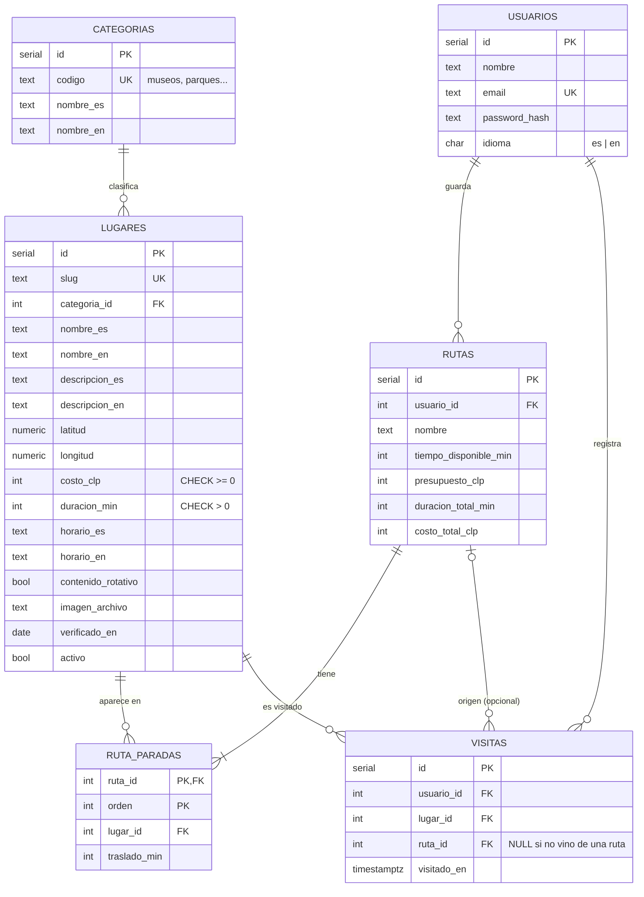

# Modelo de datos · Rutia (PostgreSQL)

Base relacional en PostgreSQL, alojada en Supabase. El script de creación es [`schema.sql`](./schema.sql) y el catálogo de lugares se carga desde [`catalogo/lugares.csv`](./catalogo/lugares.csv).

## Tablas

| Tabla | Qué guarda | Reglas importantes |
|---|---|---|
| `categorias` | Los 4 intereses que el turista puede elegir: museos, parques, patrimonio y restaurantes | Fijas; se insertan en `schema.sql` |
| `lugares` | Catálogo de puntos de interés, bilingüe | `slug` único; `costo_clp >= 0`; `duracion_min > 0`; `contenido_rotativo` marca los que cambian su oferta |
| `usuarios` | Turistas registrados | `email` único y en minúsculas; la contraseña se guarda como hash PBKDF2, nunca en texto plano |
| `rutas` | Rutas que el turista decidió guardar | Los totales los calcula el servidor; si se borra el usuario, se borran sus rutas (`CASCADE`) |
| `ruta_paradas` | Lugares de cada ruta, en orden | Clave `(ruta_id, orden)`; un lugar no se repite en la misma ruta; un lugar que está en una ruta no se puede borrar (`RESTRICT`) |
| `visitas` | Lugares que el turista marcó como visitados | Se permiten varias visitas al mismo lugar; si se borra la ruta de origen, la visita queda (`SET NULL`) |

## Por qué relacional

Los datos de Rutia tienen relaciones claras (un usuario tiene rutas, una ruta tiene paradas, una parada apunta a un lugar) y reglas que la base debe hacer cumplir aunque el código falle: un costo no puede ser negativo, un email no se repite y un lugar en uso no se borra. Las claves foráneas y los `CHECK` de PostgreSQL garantizan esas reglas en un solo lugar.

## Índices

| Índice | Para qué |
|---|---|
| `lugares(categoria_id)` | Filtrar candidatos por interés al generar una ruta |
| `lugares(costo_clp, duracion_min)` | Filtrar por presupuesto y tiempo |
| `rutas(usuario_id)` | Listar las rutas de un usuario |
| `visitas(usuario_id, lugar_id)` | Saber qué lugares ya visitó un usuario |
